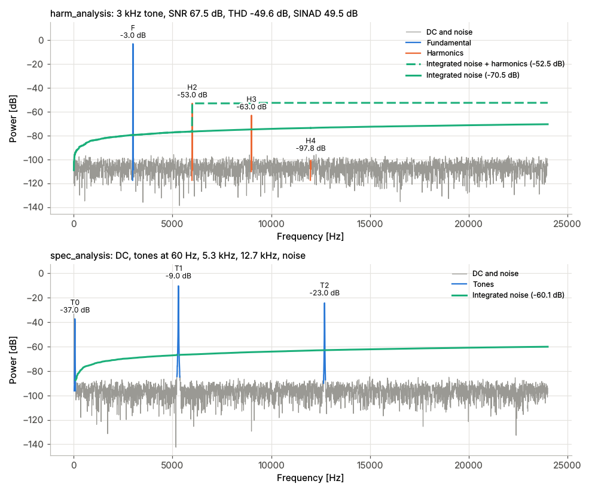

[](https://badge.fury.io/py/harm-analysis)
[](https://github.com/ericsmacedo/harm-analysis/actions/workflows/main.yml)
[](https://harm-analysis.readthedocs.io/en/latest/)
[](https://coveralls.io/github/ericsmacedo/harm-analysis?branch=main)
[](https://pypi.python.org/pypi/harm-analysis)
[](https://semver.org/)

[](https://pypi.python.org/pypi/harm-analysis)
[](https://docs.github.com/en/pull-requests/collaborating-with-pull-requests/proposing-changes-to-your-work-with-pull-requests/creating-a-pull-request)
[](https://github.com/ericsmacedo/harm-analysis/issues)

# Harmonic Analysis package

* [Documentation](https://harm-analysis.readthedocs.io/en/latest/)
* [PyPI](https://pypi.org/project/harm-analysis/)
* [Sources](https://github.com/ericsmacedo/harm-analysis)
* [Issues](https://github.com/ericsmacedo/harm-analysis/issues)

**THD, SNR, SINAD and THD+N of a signal in one call, from its FFT spectrum.**

```bash
pip install harm-analysis
```

## Introduction

The harmonic analysis package uses FFT to estimate parameters of an input signal.
The package provides two main functions:

- `harm_analysis`: for simulations with an injected tone, returning SNR, THDN, Noise, etc.
- `spec_analysis`: for cases without an injected tone, that auto-detects DC, tones, and noise from the spectrum.

<!-- overview-start -->

<!-- overview-end -->

## Why harm-analysis?

- **One call, all the metrics**: fundamental, harmonics, DC, noise, THD, SNR, SINAD and THD+N.
- **Works on real data**: no coherent sampling needed; windowing and spectral leakage are handled for you.
- **No known tone?** `spec_analysis` finds DC, tones and the noise floor by itself.
- **Plots included**: pass `plot=True` to draw the annotated spectrum.
- **Command line too**: `harm-analysis` and `spec-analysis` analyze a text file directly.

## Example

A 1 kHz tone with a -60 dB second harmonic and some noise:

```python
import numpy as np
from harm_analysis import harm_analysis

rng = np.random.default_rng(0)
fs = 48000
t = np.arange(4096) / fs
x = np.sin(2 * np.pi * 1000 * t) + 1e-3 * np.sin(2 * np.pi * 2000 * t) + 1e-4 * rng.standard_normal(t.size)

r = harm_analysis(x, fs=fs)
for name, value in r.to_dict().items():
    print(f"{name:>15}: {np.round(value, 2)}")
```

Output:

```text
        fund_db: -3.01
      fund_freq: 1000.0
      harm_freq: [1999.97 3022.05 4023.99 4958.22 5971.06]
        harm_db: [ -63.   -107.8  -103.57 -105.74 -103.45]
          dc_db: -109.41
       noise_db: -79.32
         thd_db: -59.99
         snr_db: 76.31
       sinad_db: 59.89
        thdn_db: -59.89
 total_noise_db: -79.32
```

Powers are in dB (a unit-amplitude sine is -3 dB); `thd_db`, `snr_db`, `sinad_db`
and `thdn_db` are relative to the fundamental.

See [usage](./docs/usage.md) for examples.

AI assistants (Claude, GitHub Copilot, ...) can run the analyses through the included
MCP server; see [AI assistants](./docs/ai.md).


## Installation

```bash
pip install harm-analysis
```
