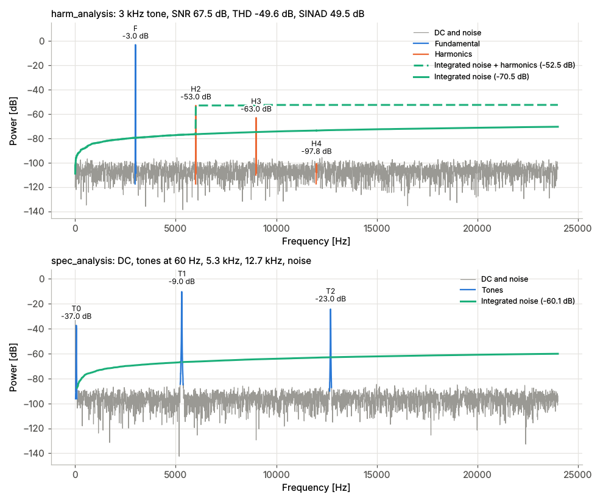

```{include} ../README.md
:relative-docs: ./docs/
:relative-images:
:end-before: <!-- overview-start -->
```



```{include} ../README.md
:relative-docs: ./docs/
:relative-images:
:start-after: <!-- overview-end -->
```

## Contents

```{toctree}
:caption: Guide
:maxdepth: 2

usage
how-it-works
corner-cases
ai
```

```{toctree}
:caption: Reference
:maxdepth: 2

api
cli
```

```{toctree}
:caption: Project
:maxdepth: 1

contributing
changelog
```
