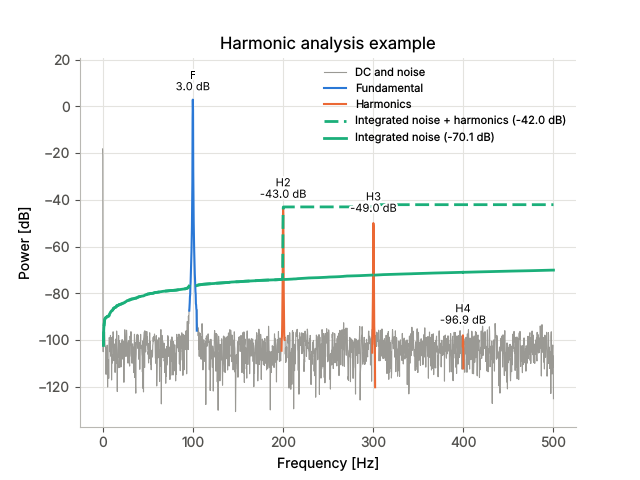
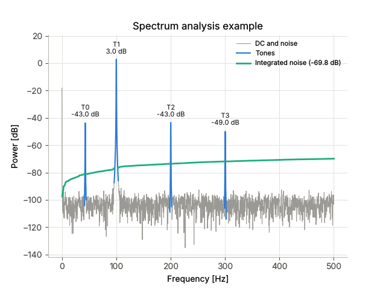

# Quickstart

```python
import numpy as np
from harm_analysis import harm_analysis

fs = 1000
t = np.arange(4096) / fs
x = np.cos(2 * np.pi * 100.3 * t) + 0.01 * np.cos(2 * np.pi * 200.6 * t)  # tone + 2nd harmonic
x += np.random.default_rng(0).normal(0, 1e-4, t.size)  # noise

results = harm_analysis(x, fs=fs)
print(f"{results.fund_freq:.2f} Hz, SNR {results.snr_db:.1f} dB, THD {results.thd_db:.1f} dB")
# 100.30 Hz, SNR 75.8 dB, THD -40.0 dB
```

There are two main functions:

- `harm_analysis`: for simulations with an injected tone, returning SNR, THDN, Noise, etc.
- `spec_analysis`: for cases without an injected tone, that auto-detects DC, tones, and noise from the spectrum.

## Results

`harm_analysis` returns a `HarmResult` and `spec_analysis` returns a `SpecResult`
(see the [API](api.md)). Each metric is an attribute, and `to_dict()` returns all
of them as a dictionary:

```python
results = harm_analysis(x, fs=fs)

results.snr_db  # signal-to-noise ratio in dB
results.thd_db  # total harmonic distortion in dB
results.harm_freq  # frequencies of the harmonics (empty array if none)

for name, value in results.to_dict().items():
    print(f"{name}: {value}")
```

## Plotting

Pass `plot=True` and a Matplotlib `ax` to draw the power spectrum. The function
draws on the `ax` you pass in, so you can keep customizing it afterwards:

```python
import matplotlib.pyplot as plt

fig, ax = plt.subplots()
results = harm_analysis(x, fs=fs, plot=True, ax=ax)

ax.set_title("My measurement")
ax.set_xscale("log")
fig.savefig("spectrum.png")
```


## Command line

The `harm-analysis` and `spec-analysis` commands run the same analyses on a text
file of samples (see [Command Line Interface](cli.md)). Add `--json` to get
machine-readable output, e.g. for scripts or AI tools:

```bash
harm-analysis data.txt --fs 1e6 --json
```

Values that are not finite (`NaN`, or `-inf` dB for a power of zero) are written
as `null`.

## `harm_analysis` example usage

This example generates a tone with noise, harmonics and a DC value.

```{literalinclude} ../examples/example_usage.py
:language: python
```

outputs:

```{literalinclude} ../examples/example_usage.md
:language: text
```



## `spec_analysis` example usage

```{literalinclude} ../examples/example_spec_analysis.py
:language: python
```

outputs:

```{literalinclude} ../examples/example_spec_analysis.md
:language: text
```


